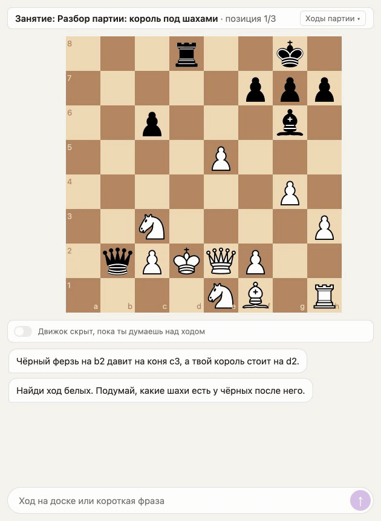
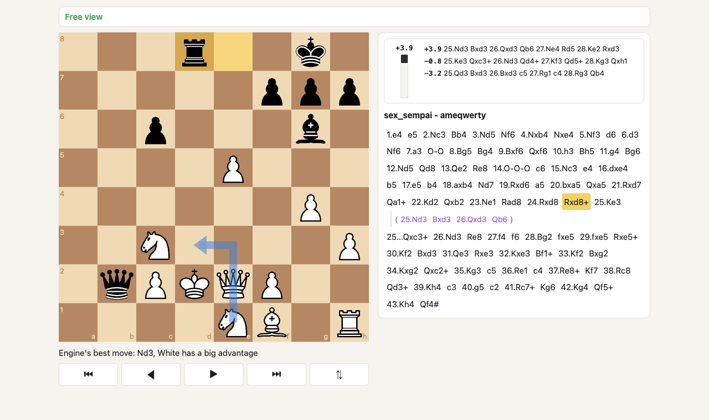
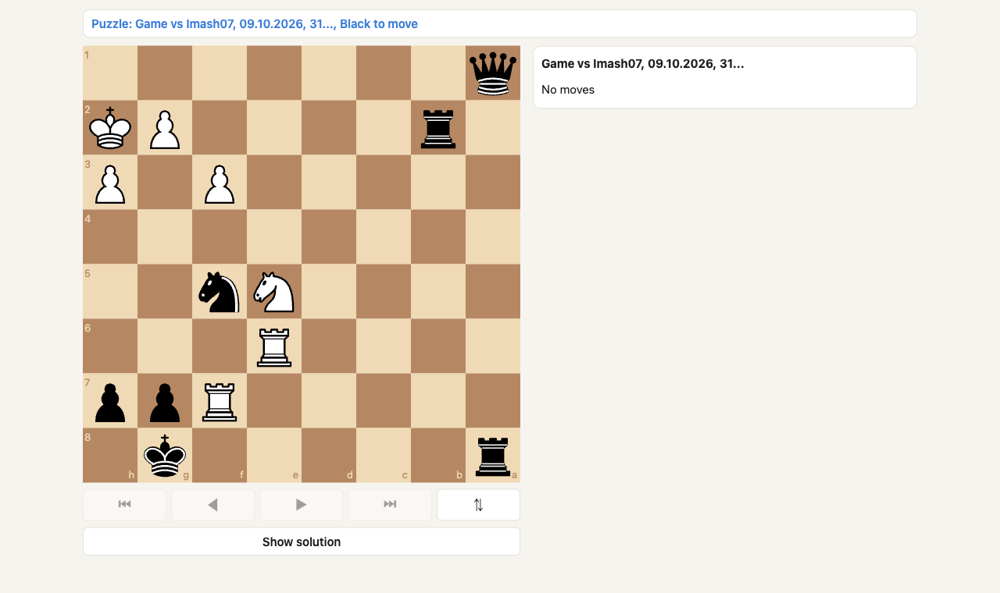
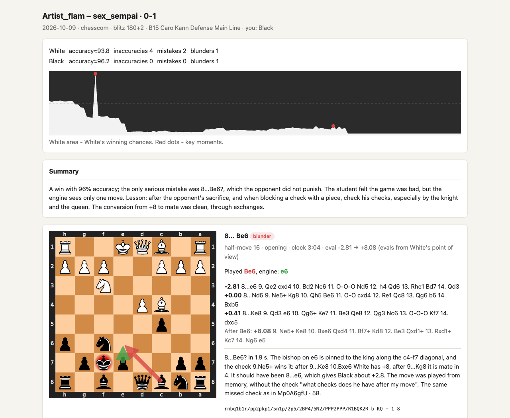

# chess-coach

A personal chess coach built on [Claude Code](https://claude.com/claude-code): Stockfish calculates, Claude explains, runs the training program and remembers your weaknesses.

[](LICENSE)



*A lesson at the board (in progress): the student answers on the board, the coach judges the move with the engine and replays the refutation move by move.*

## What It Does

- **Game import** from Lichess and chess.com, plus over-the-board games from a Lichess study or a PGN file.
- **Engine reviews** with Stockfish: every position, move classes (inaccuracy, mistake, blunder by drop in win%, Lichess thresholds), missed chances and a deep pass over critical moments.
- **HTML reports** for reviewed games with boards, an evaluation chart and the coach's notes.
- **Statistics** by time control, color and opening, plus a summary of mistakes across reviews.
- **Live board** with a move tree: the coach adds games and lines, the student browses and makes their own moves, and the coach reads them back. An optional panel shows the eval bar and engine lines.
- **Puzzles** solved on the board with the mouse, with FSRS spaced repetition. Sources: the Lichess puzzle database, puzzle books you own (imported locally), and puzzles generated from missed tactics in your own reviewed games. Every move is judged by the engine, so equivalent alternatives are accepted and wrong moves are refuted on the board.
- **Player model**: `profile/player.md` keeps ratings, goals, repertoire, confirmed weaknesses with examples, strengths, a training plan and a session log. The coach updates it after every review.
- **In progress**: lessons at the board, where the coach plays through positions with the student move by move and reacts to the student's reasoning, not only to the move.

## Screenshots



*The live board: a reviewed game, a line the coach added with an arrow and a caption, and the engine panel (eval bar and three lines).*



*A puzzle generated from a missed tactic in the student's own game, as served: the student solves it with the mouse.*



*An HTML review report: evaluation chart, the coach's summary and key moments with boards.*

## How It Works

- **Claude Code is the coach.** `CLAUDE.md` holds the coach's role and rules (the engine is the source of truth, ask before explaining, 3-5 key moments per game, a fixed list of error categories). Session scenarios live in `.claude/skills/` (`review-game`, `build-profile`).
- **`coach`** is a Python CLI on [python-chess](https://python-chess.readthedocs.io/) that Claude calls: `fetch`, `games`, `analyze`, `review`, `stats`, `show`, `report`, `board ...`, `puzzles ...`, `inbox`. Run `uv run coach --help` for the full list.
- **Stockfish 19** runs locally for `coach analyze` and `coach review`.
- **The board** is a web app in `web/`: a Nest server with MongoDB (REST and WebSocket), a Vite + React + TypeScript client with `react-chessboard` and `chess.js`. It runs in Docker Compose on `127.0.0.1:8765` and is shown in the Claude Desktop built-in browser.
- **The engine service** (`web/packages/engine`) is Stockfish 19 in Docker with a process pool and an HTTP API (`POST /analyse`, `GET /health` on `127.0.0.1:8766`). The board uses it to judge puzzle moves, and the puzzle import uses it to compute solutions.
- **A `UserPromptSubmit` hook** (`.claude/settings.json`) attaches what the student did on the board since the last message to their next message, so the coach sees moves without being told.

## Requirements

- [Claude Code](https://claude.com/claude-code); the Claude Desktop app for the built-in browser that shows the board.
- macOS on Apple Silicon (the setup guide is written for it; other platforms need adjustments).
- Homebrew, Xcode Command Line Tools.
- Stockfish 19 and [uv](https://docs.astral.sh/uv/) (Python 3.11+).
- Docker Desktop with Compose v2.
- Node 24.21.0 (pinned in `.node-version`) for board development and tests only.
- For puzzle import: poppler, `tesseract`, `zstd`.

## Quick Start

```bash
git clone https://github.com/SoundAsleep192/chess-coach.git
cd chess-coach
claude
```

First message: **"Read SETUP.md and run the setup"**. Claude installs and checks everything step by step following [SETUP.md](SETUP.md). Then ask for the first session: the `build-profile` skill downloads your games, reviews a batch of losses and fills in your profile. After that just talk: "review my last game", "here is a link: ...", "what should I train this week".

Before the first session, put your own Lichess and chess.com usernames into `coach.toml` (section `[player]`).

Note: the coach talks to the student in Russian by default. To change the language, edit `CLAUDE.md` (the first section). The error category names and the profile are in Russian too, see `CLAUDE.md`.

## Repository Layout

| Path | What it is |
|---|---|
| `CLAUDE.md` | the coach's role and rules |
| `.claude/skills/` | session scenarios: `review-game`, `build-profile` |
| `.claude/settings.json`, `.claude/launch.json` | the board hook, permissions, preview configs |
| `coach/` | the `coach` Python CLI |
| `tests/` | Python tests |
| `web/packages/server` | board server (Nest, MongoDB) |
| `web/packages/client` | board client (React) |
| `web/packages/shared` | shared types and the engine client |
| `web/packages/engine` | engine service (Stockfish 19 in Docker) |
| `web/packages/puzzles` | puzzle import (Lichess, books) |
| `docker-compose.yml` | `mongo`, `engine` and `board` services |
| `coach.toml` | accounts, engine, review thresholds, puzzle settings |
| `profile/player.md` | the player model |
| `data/` | games, reviews, book and Lichess data (mostly git-ignored) |
| `out/` | generated pages |
| `docs/superpowers/` | design specs and implementation plans (in Russian) |

## Roadmap

Done: the game → review → profile loop, the live two-way board, puzzles (Lichess, books, own games). Next: lessons at the board, Maia-2 (human-like moves at your rating and sparring), openings, endgames, and later an MCP server and a web platform. See [ROADMAP.md](ROADMAP.md).

## Privacy

This repository is the author's real coaching setup. `profile/player.md`, the accounts in `coach.toml` and the review notes in `data/reviews/*.notes.json` are the author's real data, kept public on purpose as a live example. If you fork it, replace them with your own.

Puzzles from books are extracted from your own copies of the books and stay in `data/books/`, which is git-ignored and never committed. The same goes for the Lichess database (`data/lichess/`), downloaded games and full engine reviews.

## Development

```bash
cd web && npm test
cd web && npm run typecheck
uv run pytest
```

Board development with hot reload: `docker compose up -d mongo`, then `cd web && npm run dev` (client on `http://127.0.0.1:5173`). Details are in [SETUP.md](SETUP.md), step 5.

## License

[MIT](LICENSE). Stockfish, which the project runs but does not include, is GPL-3.
